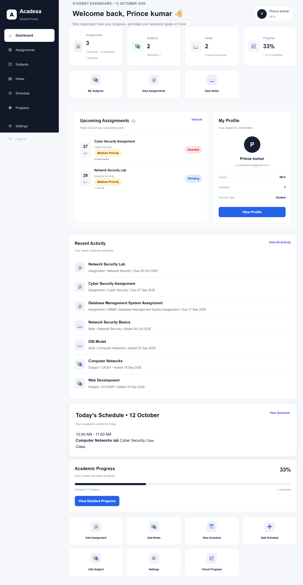

# Acadexa

## Intelligent Academic Management & Productivity Platform

Acadexa is a web-based academic management platform designed to help students organize and manage their academic activities in one place.

The system provides features for managing assignments, subjects, study notes, schedules, and academic progress through a simple and user-friendly dashboard.

## Dashboard Preview




## Features

- Student registration and login
- Personalized student dashboard
- Assignment management
- Assignment search and filtering
- Assignment priority and status tracking
- Subject management
- Study notes management
- Academic schedule management
- Progress tracking
- Overdue assignment detection
- Profile and account settings
- Responsive and user-friendly interface

## Technology Stack

- **Backend:** Python, Flask
- **Database:** SQLite
- **ORM:** Flask-SQLAlchemy
- **Frontend:** HTML, CSS, JavaScript
- **Authentication:** Flask Session
- **Development Environment:** Visual Studio Code

## Project Structure

```text
Acadexa
│
├── database/
│   └── database.py
│
├── models/
│   ├── assignment.py
│   ├── note.py
│   ├── schedule.py
│   ├── subject.py
│   └── user.py
│
├── static/
│   ├── css/
│   │   └── style.css
│   └── js/
│       └── script.js
│
├── templates/
│   ├── dashboard.html
│   ├── assignments.html
│   ├── subjects.html
│   ├── notes.html
│   ├── schedule.html
│   ├── progress.html
│   └── ...
│
├── app.py
├── requirements.txt
├── README.md
└── .gitignore